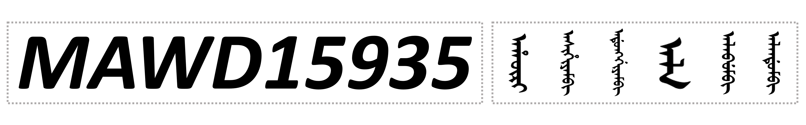

**Official paper:** [MAWD15935: A Large-Scale Manchu Archives Word Dataset](https://doi.org/10.1145/3767308.3838655)

<p align="center">
  
</p>

<h1 align="center">MAWD15935</h1>
<p align="center"><strong>A Large-Scale Manchu Archives Word Dataset</strong></p>
<p align="center"><strong>Accepted at ACM Multimedia 2026 (ACM MM '26) · Dataset Track</strong></p>
<p align="center">
  <a href="https://doi.org/10.1145/3767308.3838655">Paper</a> ·
  <a href="./Supplementary%20Material.pdf">Supplementary Material</a> ·
  <a href="#data-access">Request Dataset</a> ·
  <a href="#citation">BibTeX</a> ·
  <a href="./docs/README-CN.md">中文</a>
</p>

<p align="center">
  Jianjun He · Yucheng Wang · Fengzhi Bao · Yu Zhou · Zhengxu Jin · Ruirui Zheng
</p>
<p align="center"><em>College of Information and Communication Engineering, Dalian Minzu University</em></p>

## Overview

**MAWD15935** is a large-scale, word-level dataset developed for **Manchu archival word recognition** and historical document analysis. It contains **1,092,744 word images** representing **15,935 distinct Manchu words**, combining a lexically broad printed collection with handwritten word images extracted from authentic Qing Dynasty archives.

The printed subset is built from entries in the *New Comprehensive Manchu-Chinese Dictionary* and samples prepared in multiple typefaces. The handwritten subset comes from the **Qing Dynasty Imperial Household Department Archives in the Collection of Dalian Library**. The dataset supports research on low-resource optical character recognition (OCR), historical document understanding, script-aware recognition, and digital cultural heritage.

### Dataset at a glance

| | MAWD15935 |
|:--|--:|
| **Word images** | **1,092,744** |
| **Distinct word types** | **15,935** |
| Printed images | 975,301 |
| Authentic archival handwritten images | 117,443 |
| Printed word types | 14,275 |
| Handwritten word types | 2,805 |
| Shared word types across subsets | 1,145 |
| Typefaces used for printed document generation | 11 |

**Why the two subsets?** The printed collection extends vocabulary coverage, while the handwritten collection captures the visual complexity of historical records, including variability in handwriting, paper appearance, and document condition. All **117,443 handwritten word images** originate from genuine archival scans; the printed subset should not be interpreted as original handwritten archival material.

## Dataset Composition

### Printed word images

The printed portion contains **975,301 images** spanning **14,275 word types**. Its vocabulary was curated from the *New Comprehensive Manchu-Chinese Dictionary*. Besides scanned dictionary material, the collection includes word documents prepared using eleven Manchu typefaces:

`ZhengBai` · `WenJian` · `YaBai` · `GuFeng` · `ZhengHei` · `BiaoHei` · `WenQin` · `XingShu` · `LiuYe` · `YingBi` · `ShuKai`

### Handwritten archival word images

The handwritten portion contains **117,443 images** spanning **2,805 word types**. These images were segmented and annotated from scans of authentic Qing Dynasty archival documents held by Dalian Library. Samples are grouped by Latin-transliterated word labels (for example, `zhuwe/zhuwe_0.png`). Of the handwritten word types, **1,145** also occur in the printed vocabulary.

### Annotation and script representation

MAWD15935 supports two complementary representations: **Latin transliteration** of Manchu words and **Manchu grapheme encoding**. The latter describes the written variants of the **35 Manchu letters**, organized into **112 grapheme forms** with identifiers such as `M002`. The provided conversion references document the correspondence between Latin letters, Manchu characters, and grapheme codes.

## Data Organization

The following layout describes the dataset package supplied to researchers upon request. It is **not** a listing of files downloadable directly from this GitHub repository.

```text
MAWD15935/
├── encoding_conversion_rules/
│   ├── grapheme encoding.docx
│   ├── latin transliteration.docx
│   └── Table of Conversion Relations Between Latin Characters and Manchu Grapheme Encoding.pdf
├── extra_data/
│   ├── Manchu Dataset of Real Handwritten Archives (2805)/
│   │   ├── aba/
│   │   │   ├── aba_0.png
│   │   │   └── aba_1.png
│   │   ├── abade/
│   │   │   ├── abade_0.png
│   │   │   └── ...
│   │   └── ...
│   └── extra_data_intro.pdf
├── main_data/
│   ├── data_docx/
│   │   ├── 1.docx
│   │   ├── 2.docx
│   │   └── ...
│   └── data_docx_intro.pdf
└── main_data_anno/
    ├── annotation.xlsx
    └── main_data_anno_intro.pdf
```

| Component | Contents |
|:--|:--|
| `encoding_conversion_rules/` | Reference documents for Latin transliteration and grapheme-encoding conversion. |
| `extra_data/` | Authentic archival handwritten word images, grouped by Latin-transliterated word type, plus documentation. |
| `main_data/` | Numbered printed Manchu word documents using the eleven typefaces, plus documentation. |
| `main_data_anno/` | Word-level annotation spreadsheet and accompanying documentation. |

In `main_data_anno/annotation.xlsx`, columns **A–E** record the word identifier, Latin transliteration, Chinese meaning, remarks, and repeated identifier; columns **F–P** contain the corresponding forms in the eleven typefaces. Incorrect entries flagged in the original annotation table were removed during dataset construction.

## Benchmark Protocols

The [ACM MM '26 paper](https://doi.org/10.1145/3767308.3838655) evaluates eight recognition methods under complementary settings:

- **Sample-level evaluation:** a random **80/20 sample split**, where word types can appear in both training and testing, measures recognition of new visual instances of known vocabulary.
- **Word-disjoint evaluation:** a **word-category-based 80/20 split**, with disjoint training and testing vocabularies, examines generalization to previously unseen words.
- **Handwriting-data analysis:** experiments vary the proportion of authentic handwritten training samples while leveraging the printed subset to investigate archival-domain recognition.

These describe the **protocols reported in the paper**, rather than asserting that precomputed split files are available in this repository. Consult the paper for the evaluation setup and baseline results.

<a id="data-access"></a>
## Request Dataset Access

**MAWD15935 is distributed to researchers upon request.** To obtain the dataset, please email **any of the three contacts below** with the subject **`MAWD15935 Dataset Access Request`**:

| Contact | Role | Email |
|:--|:--|:--|
| **Ruirui Zheng** | Corresponding author | [zrr@dlnu.edu.cn](mailto:zrr@dlnu.edu.cn) |
| **Yucheng Wang** | GitHub repository owner and maintainer | [wyc_24kbaekhyun@163.com](mailto:wyc_24kbaekhyun@163.com) |
| **Jianjun He** | First author | [jianjunhe@live.com](mailto:jianjunhe@live.com) |

Please include the following information in your request:

1. **Institution / affiliation** — your university, research institute, or organization.
2. **Contact email address** — an address at which we can reach you.
3. **Intended use** — a short description of your research or educational purpose and how you plan to use MAWD15935.

The authors will review your request and provide the dataset and access instructions for research use in accordance with the applicable terms. There are **no public, direct-download links** for the complete dataset on this project page.

## Scope and Responsible Use

MAWD15935 is intended to facilitate research in historical Manchu document recognition. When interpreting results, please note that (i) the printed images are not original archival handwriting and (ii) the handwritten samples are sourced from a specific archival collection. These factors may affect cross-source and cross-style generalization.

- **Repository code:** Original code and scripts, where provided and unless otherwise stated, are covered by the **MIT License**.
- **Dataset materials:** Word images, annotations, and distributed data assets are provided for **non-commercial academic research and education**. Commercial use and redistribution of the original dataset require prior permission from the relevant rights holders. Users must preserve attribution and respect source-specific or third-party restrictions.
- **Published paper:** The ACM publication is licensed under **CC BY 4.0**. That publication license does **not** automatically extend to dataset assets, archival source material, or third-party font files.

Please cite the paper when using the dataset in publications or derivative research. For licensing or permission questions, use the contacts listed in [Request Dataset Access](#data-access).

<a id="citation"></a>
## Citation

If MAWD15935 contributes to your research, please cite the **published ACM MM 2026 paper**:

```bibtex
@inproceedings{he2026mawd15935,
  author    = {Jianjun He and Yucheng Wang and Fengzhi Bao and Yu Zhou and Zhengxu Jin and Ruirui Zheng},
  title     = {MAWD15935: A Large-Scale Manchu Archives Word Dataset},
  booktitle = {Proceedings of the 34th ACM International Conference on Multimedia},
  year      = {2026},
  publisher = {Association for Computing Machinery},
  doi       = {10.1145/3767308.3838655},
  url       = {https://doi.org/10.1145/3767308.3838655}
}
```

**Supplementary material:** [`Supplementary Material.pdf`](./Supplementary%20Material.pdf) provides additional explanations of Manchu grapheme cases and their statistical distributions.

## Questions and Maintenance

For dataset access, annotations, permissions, or collaboration, contact the authors through the addresses above. For documentation corrections and repository-related issues, please use [GitHub Issues](https://github.com/DevilEnfant/MAWD15935/issues).
